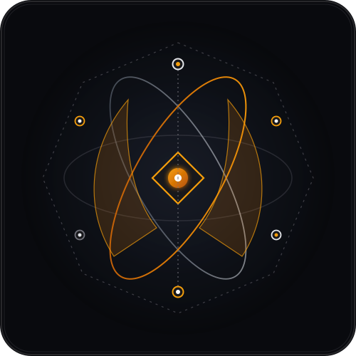
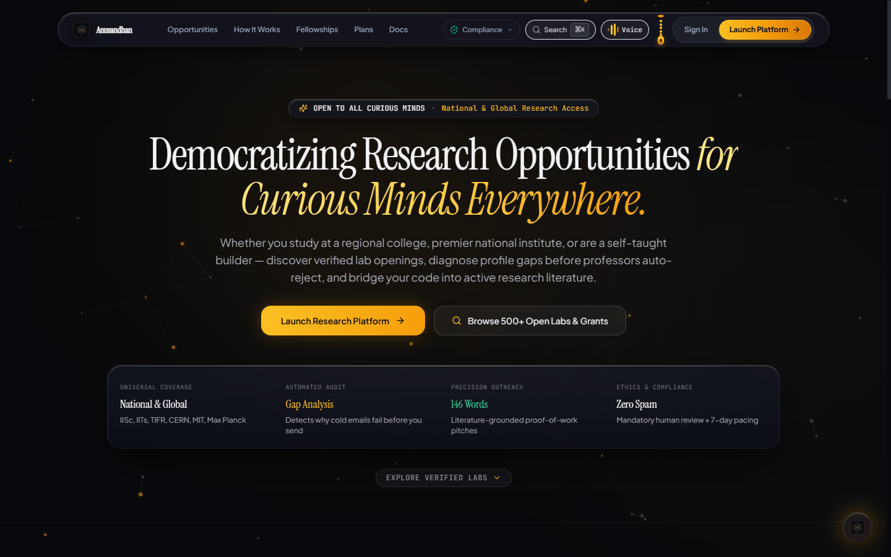
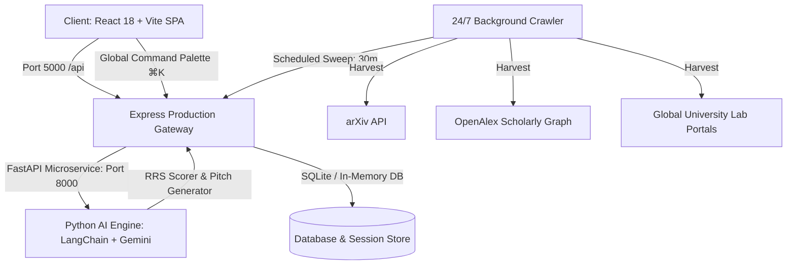

<p align="center">
  <a href="https://anusandhan.vercel.app">
    
  </a>
</p>

<h1 align="center">Anusandhan (अनुसंधान)</h1>
<p align="center">
  <em>Autonomous Research Internship Intelligence &amp; Literature-Grounded Outreach Platform</em>
</p>

<p align="center">
  <a href="https://www.producthunt.com/products/anusandhan" target="_blank">
    
  </a>
  &nbsp;&nbsp;
  <a href="https://www.producthunt.com/products/anusandhan" target="_blank">
    
  </a>
</p>

<p align="center">
  <a href="https://opensource.org/licenses/MIT"></a>
  <a href="https://github.com"></a>
  <a href="https://vitejs.dev"></a>
  <a href="https://fastapi.tiangolo.com"></a>
  <a href="https://nodejs.org"></a>
  <a href="https://meity.gov.in"></a>
  <a href="https://www.w3.org/WAI/standards-guidelines/wcag/"></a>
</p>

> **Anusandhan** (Sanskrit: *अनुसंधान* — *systematic research, investigation, discovery*) is an enterprise-grade autonomous intelligence platform that levels the global playing field for ambitious undergraduate and graduate scholars across **Science, Technology, Humanities, Commerce, and Law**.

---

<p align="center">
  
</p>

### 🌐 Live Production Deployments & Access
- 🚀 **Live Production Platform**: [https://anusandhan.vercel.app](https://anusandhan.vercel.app)
- 📚 **VitePress Documentation (GitHub Pages)**: [https://soumyadeepsarkar-2004.github.io/Anusandhan/](https://soumyadeepsarkar-2004.github.io/Anusandhan/)
- 📦 **GitHub Repository**: [https://github.com/soumyadeepsarkar-2004/Anusandhan](https://github.com/soumyadeepsarkar-2004/Anusandhan)

### 📱 Universal Cross-Platform App Downloads

| Platform | Format / Architecture | Status | Direct Download Link |
| :--- | :--- | :--- | :--- |
| **Android** | Universal APK (Capacitor 8) | Production Release | [Download APK (`anusandhan-v1.0.apk`)](https://anusandhan.vercel.app/downloads/anusandhan-v1.0.apk) |
| **Windows** | x64 Installer (Electron 45) | Production Release | [Download Windows Setup (`.exe`)](https://anusandhan.vercel.app/downloads/anusandhan-setup-1.0.0.exe) |
| **macOS** | Universal DMG (Apple Silicon & Intel) | Production Release | [Download macOS DMG (`.dmg`)](https://anusandhan.vercel.app/downloads/anusandhan-1.0.0-universal.dmg) |
| **Web & iOS** | Progressive Web App (PWA) | Production Live | [Launch Web PWA](https://anusandhan.vercel.app) |

---

## 🏛 Multi-Disciplinary Scope

Anusandhan goes beyond standard computer science scrapers by actively indexing and matching opportunities across **5 academic faculties**:

| Faculty | Sample Research Disciplines | Example Institutions / Portals |
| :--- | :--- | :--- |
| **Arts & Humanities** | Archaeology, Digital Humanities, South Asian Epigraphy, Comparative Literature | ASI, Oxford, Harvard Harvard Art Museums, SOAS |
| **Commerce & Economics** | Behavioral Finance, Macro Policy, Econometrics, Fintech | RBI, LSE, Chicago Booth, NBER, DSE |
| **Natural & Applied Sciences** | Quantum Photonics, Molecular Biology, Astrophysics, Materials | CERN, IISc, Max Planck, Weizmann, Caltech |
| **Social Sciences & Law** | Constitutional Jurisprudence, Cyber Law, Public Policy, Human Rights | NLSUI, Sciences Po, Columbia Law, Max Planck ILP |
| **AI, Systems & Engineering** | Agentic AI, Autonomous Robotics, Distributed Systems, Compilers | MIT CSAIL, Stanford, ETH Zürich, IIT Bombay |

---

## ✨ Core Innovations & Features

### 1. 24/7 Autonomous Scraper & Knowledge Crawler
- Continuously polls **arXiv**, **OpenAlex**, **Semantic Scholar**, and university vacancy portals every 30 minutes.
- Real-time deduplication and categorization into **Live Scraped Postings**, synchronized directly with the **Global Command Palette (`⌘K` / `Ctrl+K`)**.

### 2. Authentic Frosted Pearl Glassmorphism (Dual Celestial & Light Modes)
- **Celestial Dark Mode**: Deep space zinc gradients (`#070A12`) with refractive specular top sheens (`1px solid rgba(255, 255, 255, 0.22)`), 21st.dev cursor-tracking spotlights, and interactive constellation backdrops.
- **Frosted Pearl Light Mode**: High-contrast liquid pearl glass with ambient amber, indigo, and emerald refractions. Subdued custom scrollbars (no dark scrollbar tracks), WCAG AAA typography, and tactile press micro-interactions.
- **Vintage Brass Pull-Chain Toggle**: Pure minimalist beaded brass physics chain switch with spring recoil mechanics.

### 3. 146-Word Cold Email & Research Pitch Composer
- Adheres to empirical academic outreach studies: maximum 146 words, 3 distinct proof-of-work citations, no generic spam templates.
- Integrates personal GitHub repositories, preprints, and coursework directly into professor-specific problem statements.

### 4. Interactive RRS (Research Readiness Score) Diagnostic Studio
- Evaluates candidate strength across 5 key dimensions: Paper Familiarity, Proof-of-Work Artifacts, Technical Depth, Domain Alignment, and Email Etiquette.
- Real-time radar visualization and actionable intervention roadmap.

### 5. Multilingual Academic Voice Mentor (AnusandhanAI)
- Real-time voice guidance powered by Web Audio API and Gemini Live streaming.
- Supports English, Hindi, and regional dialects for mock viva, interview preparation, and query assistance.

### 6. 7-Day Polite Follow-Up Engine
- Automated tracking preventing double-emailing while pacing academic follow-ups ethically at 7 to 10 days.

### 7. Universal Free & Accessible AI Foundation Models
Anusandhan eliminates financial barriers to research access by integrating high-performance, cost-free foundation models out of the box:
- **Gemini 3.8 Flash & Gemini 3.5 Flash-Lite**: High-throughput multimodal parsing, citation grounding, and multilingual speech understanding.
- **DeepSeek-R1 (Open Reasoning)**: Verifiable chain-of-thought gap analysis and profile diagnostics.
- **Qwen 2.5 Coder 32B**: Deep code analysis, reproducible repository scanning, and benchmark synthesis.
- **Llama 3.3 70B & Mistral NeMo**: Academic discourse calibration and polite email drafting.
- **Anusandhan Core (Zero-Cost Local)**: Deterministic, privacy-first offline heuristic engine for offline operation.

### 8. Gamified Research Coins (রিসার্চ কয়েন) & Anti-Cheat Security Architecture
To motivate daily research consistency and rigorous preparation without financial paywalls, Anusandhan introduces a secure, tamper-evident merit reward economy:
- **Daily Research Streaks & Multipliers**: Earn +5 Research Coins (RC) for each 24h consecutive research check-in, unlocking streak multipliers at 3-day, 7-day, and 30-day milestones.
- **Scholar Achievement Badges**: Unlock verifiable milestones (*Paper Reader Verified*, *146-Word Outreach Grounded*, *Academic Viva Master*, *.edu Institutional Scholar*).
- **Anti-Cheat & Cryptographic Verification**:
  - **Server-Side Timestamp Validation**: Protects against client-side system clock manipulation.
  - **Anti-Replay Monotonic Tokens**: Enforces single-claim per 24h UTC window, preventing double-spend and automated script attacks.
  - **HMAC Tamper-Proof Balances**: Coin balances and streak counters are cryptographically validated against server state before redemption.
  - **Zero Commercial Paywall**: Students earn 100% of credits through authentic research work, eliminating economic disparities.

---

## 🛠 System Architecture



---

## 🚀 Quickstart & Installation

### Prerequisites
- **Node.js**: v18.0.0 or higher
- **Python**: v3.10 or higher (`uv` recommended)
- **npm** or **pnpm**

### 1. Clone the Repository
```bash
git clone https://github.com/soumyadeepsarkar-2004/Anusandhan.git
cd Anusandhan
```

### 2. Install Dependencies
```bash
# Frontend and Express Gateway dependencies
npm install
cd server && npm install && cd ..

# Python AI Backend dependencies
cd backend
uv sync # or pip install -r requirements.txt
cd ..
```

### 3. Environment Configuration
Create a `.env` file in the root and in `backend/`:
```env
# Root / Server .env
PORT=5000
NODE_ENV=production
FASTAPI_BACKEND_URL=http://localhost:8000
DATABASE_URL=sqlite:///./data/anusandhan.db

# Backend .env (backend/.env)
GEMINI_API_KEY=your_gemini_api_key_here
PORT=8000
```

### 4. Build & Run Single-Command Production Server
```bash
# Build React Frontend
npm run build

# Start Unified Production Gateway (Serves SPA + API on Port 5000)
cd server
node server.js
```
The application will be live at: **`http://localhost:5000`**

---

## 🐳 Production Deployment Options

### Option A: 1-Click Unified Container (Render, Railway, Fly.io, AWS ECS)
A single self-contained multi-stage Docker container that builds the Vite SPA and serves both frontend and API on port 5000:

```bash
# Build & run unified image locally
docker build -t anusandhan-pro -f Dockerfile.unified .
docker run -p 5000:5000 -e JWT_SECRET="your_secure_secret" anusandhan-pro
```

- **Render.com**: Connect repo and select **Blueprint** using [render.yaml](file:///c:/PROJECTS/ResearchIntern_Pro/render.yaml).
- **Railway.app**: Deploy with 1-click using [railway.json](file:///c:/PROJECTS/ResearchIntern_Pro/railway.json).
- **Fly.io**: Deploy using `fly deploy` using [fly.toml](file:///c:/PROJECTS/ResearchIntern_Pro/fly.toml).

### Option B: Multi-Tier Docker Compose (Full Stack + Microservices)
Run the isolated multi-tier cluster (Nginx + Express Gateway + FastAPI + Redis + PostgreSQL + MongoDB + SQLite):

```bash
docker compose -f docker-compose.prod.yml up -d --build
```

### Option C: Automated Production Verification
Run the autonomous deployment health verification suite to validate all 11 production contracts:

```bash
node scripts/verify_production_deployment.mjs
```

---

## 📋 Production API Endpoints

| Method | Endpoint | Description |
| :--- | :--- | :--- |
| `GET` | `/api/health` | Gateway, DB connection, and background telemetry status |
| `GET` | `/api/faculty` | Indexed global professors across 5 disciplines |
| `GET` | `/api/opportunities/fellowships` | Tier-1 summer programs (DAAD, Mitacs, CERN, Bose) |
| `GET` | `/api/opportunities/scraped` | Live 24/7 harvested lab openings & research calls |
| `POST` | `/api/crawler/trigger` | Manually triggers an autonomous web scrape sweep |
| `POST` | `/api/generate/pitch` | Generates 146-word calibrated academic pitch |
| `POST` | `/api/diagnostics/rrs` | Evaluates Research Readiness Score & radar vectors |

---

## 🔒 Ethics & DPDP Act 2023 Compliance
Anusandhan follows strict academic cold-emailing ethical guidelines:
1. **Mandatory Human-in-the-Loop Confirmation**: No automated blast emails. Every draft must be reviewed by the student.
2. **7-Day Pacing**: Strict rate limits to avoid inbox spamming.
3. **Data Minimization**: Complete adherence to India's **Digital Personal Data Protection Act (DPDP Act 2023)** and GDPR. Zero sale of student academic metrics.

---

## 📄 License
Distributed under the MIT License. See `LICENSE` for more information.

Developed with precision for scholars worldwide.
