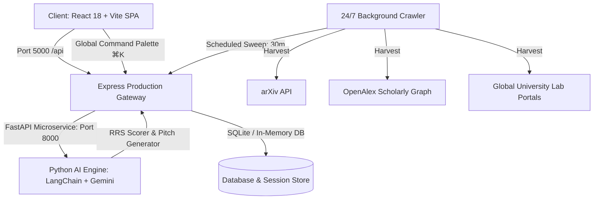

# Anusandhan PRO (अनुसंधान)
### Autonomous Research Internship Intelligence & Literature-Grounded Outreach Platform

[](https://opensource.org/licenses/MIT)
[](https://github.com)
[](https://vitejs.dev)
[](https://fastapi.tiangolo.com)
[](https://nodejs.org)
[](https://meity.gov.in)
[](https://www.w3.org/WAI/standards-guidelines/wcag/)

> **Anusandhan** (Sanskrit: *अनुसंधान* — *systematic research, investigation, discovery*) is an enterprise-grade autonomous intelligence platform that levels the global playing field for ambitious undergraduate and graduate scholars across **Science, Technology, Humanities, Commerce, and Law**.

---

## 🏛 Multi-Disciplinary Scope

Anusandhan goes beyond standard computer science scrapers by actively indexing and matching opportunities across **5 academic faculties**:

| Faculty | Sample Research Disciplines | Example Institutions / Portals |
| :--- | :--- | :--- |
| **Arts & Humanities** | Archaeology, Digital Humanities, South Asian Epigraphy, Comparative Literature | ASI, Oxford, Harvard Harvard Art Museums, SOAS |
| **Commerce & Economics** | Behavioral Finance, Macro Policy, Econometrics, Fintech | RBI, LSE, Chicago Booth, NBER, DSE |
| **Natural & Applied Sciences** | Quantum Photonics, Molecular Biology, Astrophysics, Materials | CERN, IISc, Max Planck, Weizmann, Caltech |
| **Social Sciences & Law** | Constitutional Jurisprudence, Cyber Law, Public Policy, Human Rights | NLSUI, Sciences Po, Columbia Law, Max Planck ILP |
| **AI, Systems & Engineering** | Agentic AI, Autonomous Robotics, Distributed Systems, Compilers | MIT CSAIL, Stanford, ETH Zürich, IIT Bombay |

---

## ✨ Core Innovations & Features

### 1. 24/7 Autonomous Scraper & Knowledge Crawler
- Continuously polls **arXiv**, **OpenAlex**, **Semantic Scholar**, and university vacancy portals every 30 minutes.
- Real-time deduplication and categorization into **Live Scraped Postings**, synchronized directly with the **Global Command Palette (`⌘K` / `Ctrl+K`)**.

### 2. Authentic Frosted Pearl Glassmorphism (Dual Celestial & Light Modes)
- **Celestial Dark Mode**: Deep space zinc gradients (`#070A12`) with refractive specular top sheens (`1px solid rgba(255, 255, 255, 0.22)`), 21st.dev cursor-tracking spotlights, and interactive constellation backdrops.
- **Frosted Pearl Light Mode**: High-contrast liquid pearl glass with ambient amber, indigo, and emerald refractions. Subdued custom scrollbars (no dark scrollbar tracks), WCAG AAA typography, and tactile press micro-interactions.
- **Vintage Brass Pull-Chain Toggle**: Pure minimalist beaded brass physics chain switch with spring recoil mechanics.

### 3. 146-Word Cold Email & Research Pitch Composer
- Adheres to empirical academic outreach studies: maximum 146 words, 3 distinct proof-of-work citations, no generic spam templates.
- Integrates personal GitHub repositories, preprints, and coursework directly into professor-specific problem statements.

### 4. Interactive RRS (Research Readiness Score) Diagnostic Studio
- Evaluates candidate strength across 5 key dimensions: Paper Familiarity, Proof-of-Work Artifacts, Technical Depth, Domain Alignment, and Email Etiquette.
- Real-time radar visualization and actionable intervention roadmap.

### 5. Multilingual Academic Voice Mentor (AnusandhanAI)
- Real-time voice guidance powered by Web Audio API and Gemini Live streaming.
- Supports English, Hindi, and regional dialects for mock viva, interview preparation, and query assistance.

### 6. 7-Day Polite Follow-Up Engine
- Automated tracking preventing double-emailing while pacing academic follow-ups ethically at 7 to 10 days.

---

## 🛠 System Architecture



---

## 🚀 Quickstart & Installation

### Prerequisites
- **Node.js**: v18.0.0 or higher
- **Python**: v3.10 or higher (`uv` recommended)
- **npm** or **pnpm**

### 1. Clone the Repository
```bash
git clone https://github.com/your-username/ResearchIntern_Pro.git
cd ResearchIntern_Pro
```

### 2. Install Dependencies
```bash
# Frontend and Express Gateway dependencies
npm install
cd server && npm install && cd ..

# Python AI Backend dependencies
cd backend
uv sync # or pip install -r requirements.txt
cd ..
```

### 3. Environment Configuration
Create a `.env` file in the root and in `backend/`:
```env
# Root / Server .env
PORT=5000
NODE_ENV=production
FASTAPI_BACKEND_URL=http://localhost:8000
DATABASE_URL=sqlite:///./data/anusandhan.db

# Backend .env (backend/.env)
GEMINI_API_KEY=your_gemini_api_key_here
PORT=8000
```

### 4. Build & Run Single-Command Production Server
```bash
# Build React Frontend
npm run build

# Start Unified Production Gateway (Serves SPA + API on Port 5000)
cd server
node server.js
```
The application will be live at: **`http://localhost:5000`**

---

## 🐳 Docker Production Deployment

Run the complete multi-tier stack (Express Gateway + FastAPI + Background Scraper + SQLite persistence) with a single command:

```bash
docker compose -f docker-compose.prod.yml up -d --build
```

### Services Started:
- **Web & Gateway**: `http://localhost:5000`
- **FastAPI AI Service**: `http://localhost:8000/docs`
- **Health Check**: `http://localhost:5000/api/health`

---

## 📋 Production API Endpoints

| Method | Endpoint | Description |
| :--- | :--- | :--- |
| `GET` | `/api/health` | Gateway, DB connection, and background telemetry status |
| `GET` | `/api/faculty` | Indexed global professors across 5 disciplines |
| `GET` | `/api/opportunities/fellowships` | Tier-1 summer programs (DAAD, Mitacs, CERN, Bose) |
| `GET` | `/api/opportunities/scraped` | Live 24/7 harvested lab openings & research calls |
| `POST` | `/api/crawler/trigger` | Manually triggers an autonomous web scrape sweep |
| `POST` | `/api/generate/pitch` | Generates 146-word calibrated academic pitch |
| `POST` | `/api/diagnostics/rrs` | Evaluates Research Readiness Score & radar vectors |

---

## 🔒 Ethics & DPDP Act 2023 Compliance
Anusandhan follows strict academic cold-emailing ethical guidelines:
1. **Mandatory Human-in-the-Loop Confirmation**: No automated blast emails. Every draft must be reviewed by the student.
2. **7-Day Pacing**: Strict rate limits to avoid inbox spamming.
3. **Data Minimization**: Complete adherence to India's **Digital Personal Data Protection Act (DPDP Act 2023)** and GDPR. Zero sale of student academic metrics.

---

## 📄 License
Distributed under the MIT License. See `LICENSE` for more information.

Developed with precision for scholars worldwide.
